University: [ITMO University](https://itmo.ru/ru/)
Faculty: [FICT](https://fict.itmo.ru)
Course: [Cloud platforms as the basis of technology entrepreneurship](https://github.com/itmo-ict-faculty/cloud-platforms-as-the-basis-of-technology-entrepreneurship)
Year: 2026/2027
Group: U4225
Author: Levina Maria Yurievna
Lab: Lab1
Date of create: 29.10.2026
Date of finished: XX.XX.2026

# Лабораторная работа 1. Обзор Google Cloud и исследование основных сервисов

**Цель:** познакомиться с основными возможностями Google Cloud: управлением доступом (IAM), сервисными аккаунтами, виртуальными машинами (Compute Engine) и хранилищем (Cloud Storage).

**Проект:** учебный проект курса `cloud-platforms-as-the-basis`.

## Основные понятия

| Понятие | Что это простыми словами |
|---|---|
| **Проект** | «Офис» в облаке: внутри все ресурсы, на него приходит один счёт |
| **IAM** (Identity and Access Management) | Система, которая решает, *кто* и *что* может делать в проекте |
| **Сервисный аккаунт** | «Пропуск» не для человека, а для программы или виртуальной машины |
| **Роль** | Набор прав, записанный на пропуске (например, «полный доступ к хранилищу») |
| **Compute Engine** | Аренда виртуальных машин в дата-центрах Google |
| **Cloud Storage, бакет** | Хранилище файлов (объектов); бакет — «шкаф» для них |
| **Spot VM** | Машина со скидкой до 60–91 %, которую Google может остановить в любой момент |

## Ход работы

### 1. Сервисный аккаунт с ролью Storage Admin

В разделе **IAM & Admin → Service Accounts** создан сервисный аккаунт `mlevina-sa-lab1` (имя по правилу «инициал + фамилия + суффикс»).


Аккаунту выдана роль **Storage Admin** (`roles/storage.admin`) — полный доступ к бакетам и объектам Cloud Storage проекта.

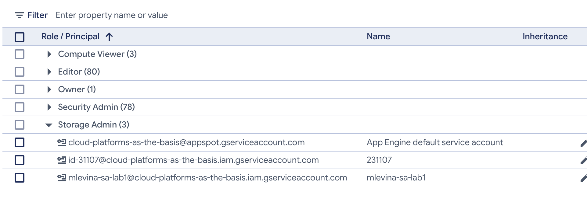

На странице IAM также видна ролевая модель учебного проекта: у студентов роли Editor и Security Admin, роль Owner — одна, у преподавателя.

### 2. Виртуальная машина e2-micro в режиме Spot

Создана машина `mlevina-vm-lab1`, зона `us-central1-a`:

- **Machine type:** `e2-micro` — 0,25–2 vCPU на общем ядре (shared core), 1 ГБ памяти. Самый маленький и дешёвый тип.
- **Provisioning model:** `Spot`. Консоль предупреждает, что выбор окончательный (*«Choice is permanent»*), а время предупреждения перед остановкой — 0 секунд.
- **Service account:** `mlevina-sa-lab1` — машина обращается к Google API от имени этого аккаунта.
- **Access scopes:** *Allow full access to all Cloud APIs*. Доступ машины проверяется дважды: по scopes (какие API можно вызывать) и по ролям IAM (что можно делать). При полном scope доступ определяют только роли, поэтому эксперимент в шаге 4 честный.

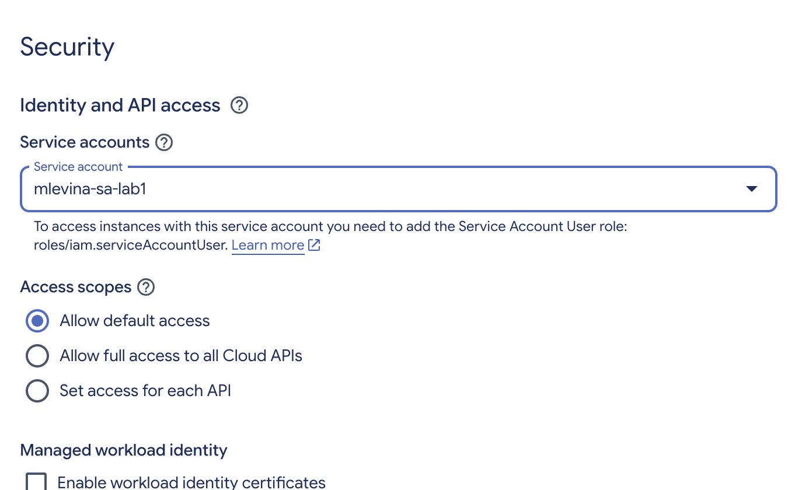

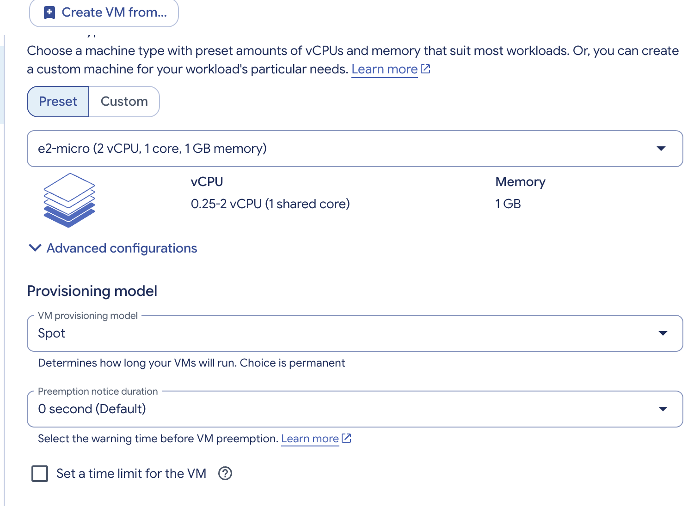

**Наблюдение про Spot.** Между занятиями (29.10 → 02.11) Google остановил машину сам: она оказалась в статусе *Stopped*. Это и есть поведение Spot — дешёвые мощности, которые облако может забрать. Машину запустили снова кнопкой **Start / Resume**.

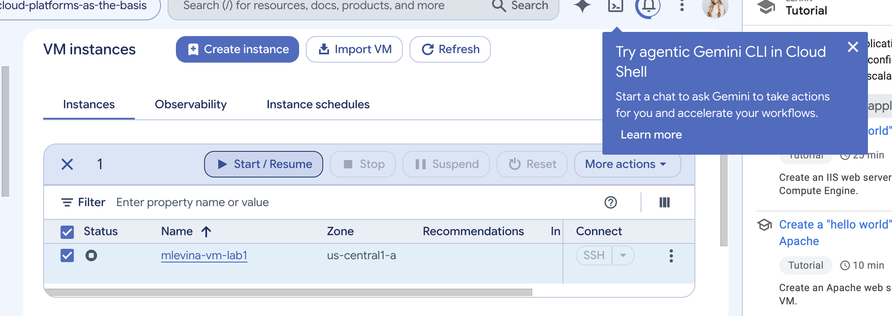

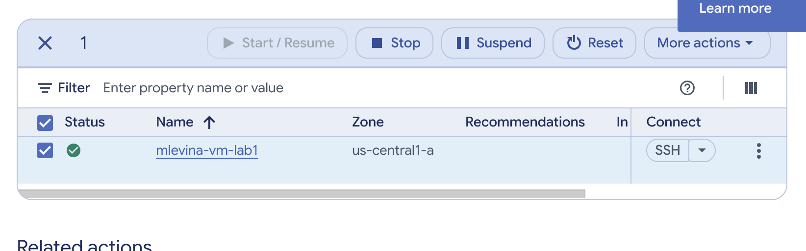

### 3. Копирование файлов из бакета (роль Storage Admin)

Подключение к машине — кнопкой **SSH** (SSH-in-browser). Команды:

```bash
gcloud storage ls                                    # бакеты проекта
gcloud storage ls gs://lab1-bucket-itmo              # файлы в бакете
mkdir ~/lab1
gcloud storage cp "gs://lab1-bucket-itmo/*" ~/lab1/  # копирование
ls -lah ~/lab1
```

Результат: бакет `lab1-bucket-itmo` найден, все 3 файла (`pic1.jpg` 228K, `pic2.jpg` 487K, `pic3.jpeg` 858K, всего 1,5 МиБ) скопированы на машину — `Completed files 3/3`.

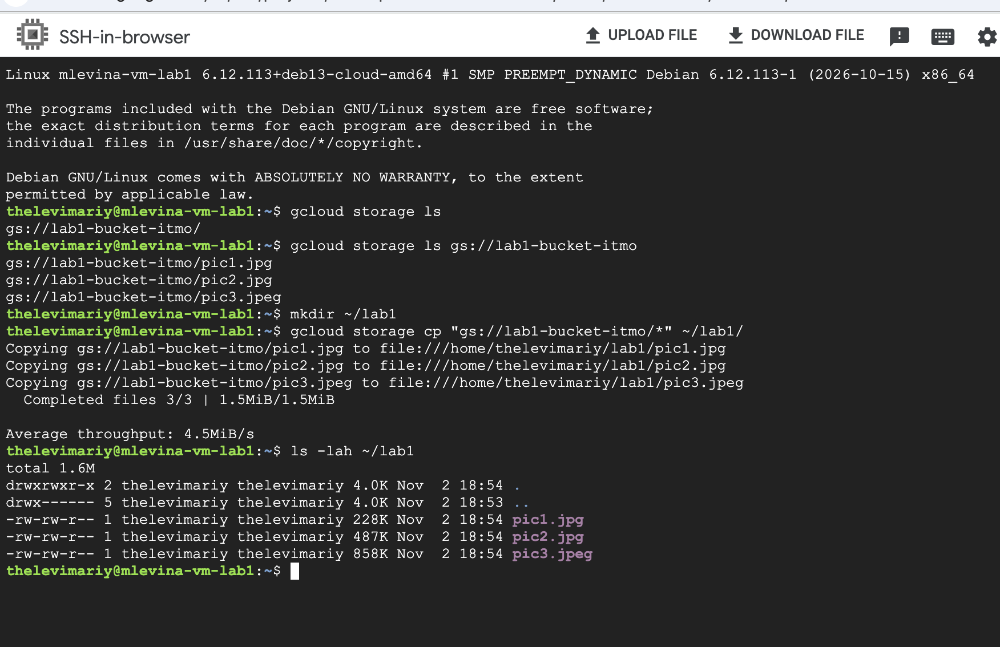

### 4. Смена роли на Compute Viewer и повторная проверка

В IAM роль аккаунта заменена: **Storage Admin → Compute Viewer** (`roles/compute.viewer`). Описание роли в консоли: *«Read-only access to get and list information about all Compute Engine resources… does not allow reading the data stored on them»* — только просмотр ресурсов Compute Engine.

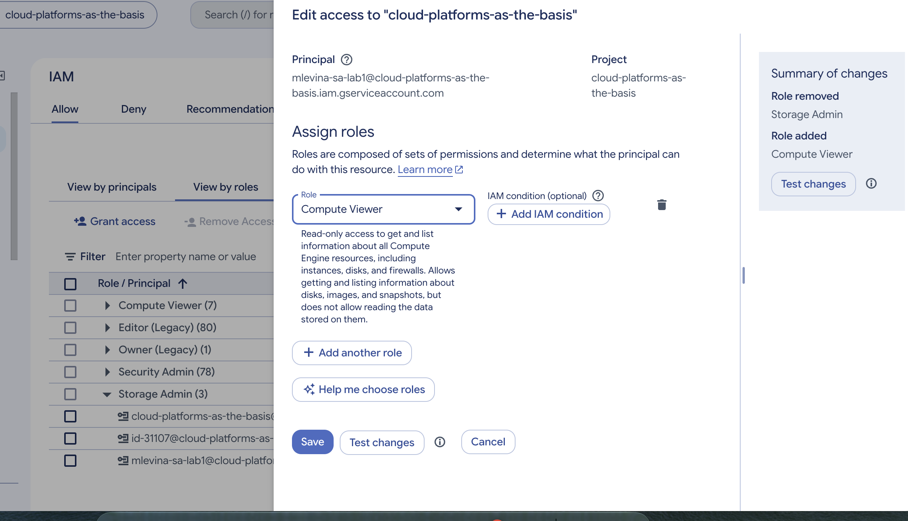

**Неожиданный результат.** Повторное копирование в `~/lab1_try2` снова прошло успешно (3/3).

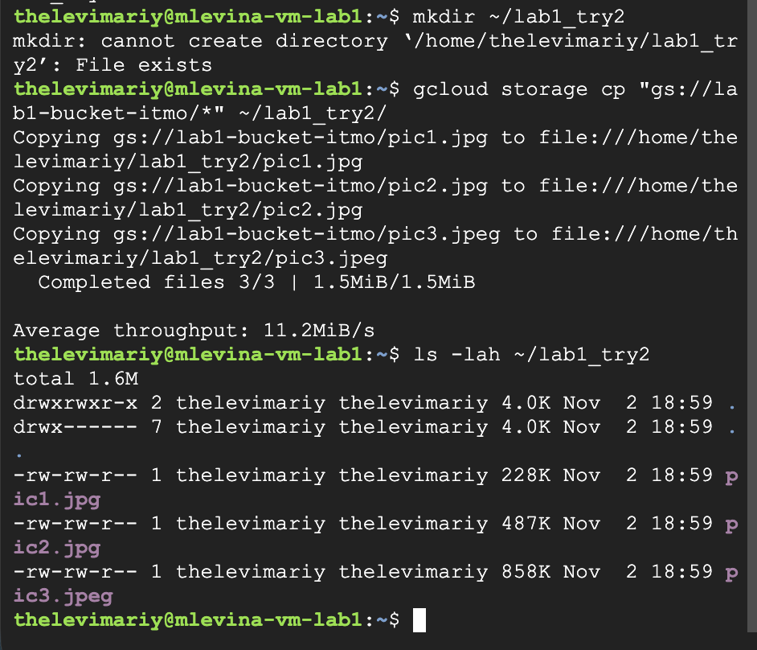

Чтобы разобраться, выполнена диагностика:

```bash
gcloud auth list
#  ACTIVE  ACCOUNT
#  *       mlevina-sa-lab1@cloud-platforms-as-the-basis.iam.gserviceaccount.com

curl -s -o /dev/null -w "%{http_code}\n" \
  https://storage.googleapis.com/lab1-bucket-itmo/pic1.jpg
#  200
```

- Машина действительно работает от имени `mlevina-sa-lab1`.
- Запрос к файлу **без какой-либо авторизации** вернул `200 OK` — **объекты бакета публичные** (доступны всем в интернете). Поэтому чтение файлов не зависит от роли сервисного аккаунта.

Тогда роль проверена на действиях, которые публично не открыты:

| Действие | Команда | Storage Admin | Compute Viewer |
|---|---|---|---|
| Список бакетов проекта | `gcloud storage ls` | ✅ видит `lab1-bucket-itmo` | ❌ **403**: нет `storage.buckets.list` |
| Скачать файлы из бакета | `gcloud storage cp gs://… ~/` | ✅ | ✅ — файлы публичные |
| Записать файл в бакет | `gcloud storage cp ~/file gs://…` | — | ❌ **403**: нет `storage.objects.create` |
| Список виртуальных машин | `gcloud compute instances list` | — | ✅ видна `mlevina-vm-lab1`, `PREEMPTIBLE true` |

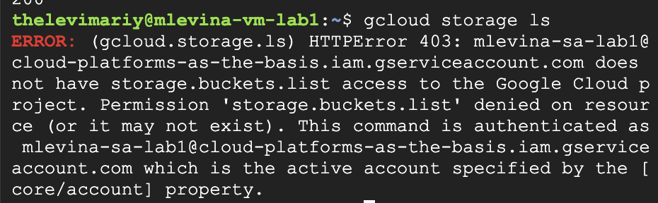

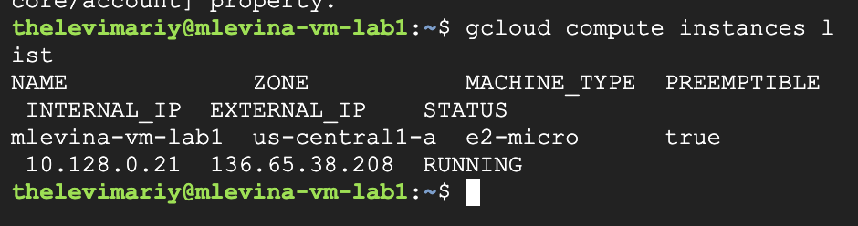

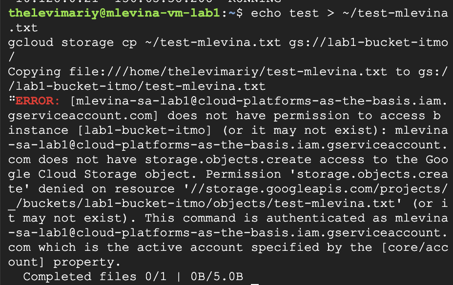

### 5. Удаление ресурсов

Удалены виртуальная машина, привязка роли в IAM и сервисный аккаунт.

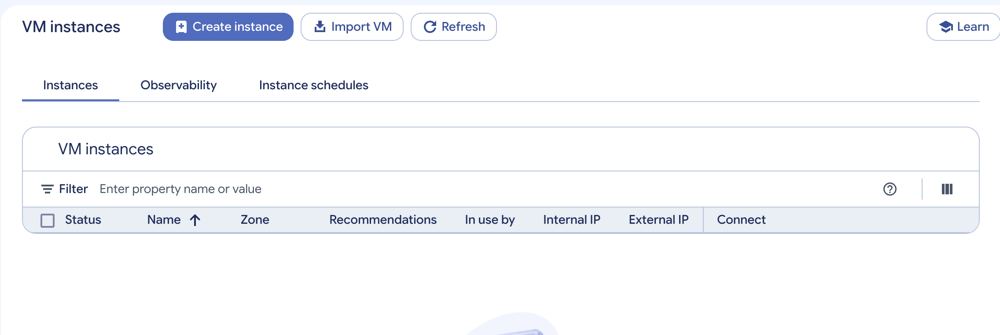

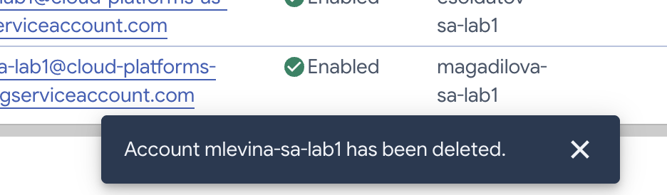

## Выводы

1. **Права в облаке определяет роль, а не машина.** Одна и та же машина с той же командой получала доступ или ошибку `403` в зависимости от роли сервисного аккаунта. Сообщение об ошибке называет конкретное недостающее право (`storage.buckets.list`, `storage.objects.create`), что упрощает диагностику.
2. **Публичный доступ сильнее IAM-ограничений.** Объекты `lab1-bucket-itmo` открыты для всех (`curl` без авторизации → `200`), поэтому их можно читать при любой роли. Ограничивать доступ ролями имеет смысл только к тому, что не опубликовано; публиковать данные нужно осознанно.
3. **Принцип минимальных привилегий.** Storage Admin даёт полный контроль над всеми бакетами проекта — для задачи «скачать файлы» это избыточно. Достаточно роли **Storage Object Viewer** на конкретный бакет: если пропуск утечёт, вред будет минимальным.
4. **Доступ машины проверяется на двух уровнях:** access scopes и роли IAM.
5. **Spot-машины дёшевы, но ненадёжны:** за несколько дней облако само остановило машину. Spot подходит для учебных, пакетных и прерываемых задач, но не для сервисов, которые должны работать постоянно.
6. **Ресурсы нужно удалять за собой:** работающая машина тратит деньги, а забытый сервисный аккаунт с широкими правами — это риск безопасности.
