University: [ITMO University](https://itmo.ru/ru/)
Faculty: [FICT](https://fict.itmo.ru)
Course: [Cloud platforms as the basis of technology entrepreneurship](https://github.com/itmo-ict-faculty/cloud-platforms-as-the-basis-of-technology-entrepreneurship)
Year: 2026/2027
Group: U4225
Author: Levina Maria Yurievna
Lab: Lab2
Date of create: 02.11.2026
Date of finished: XX.XX.2026

# Лабораторная работа 2. Исследование Cloud Run

**Цель:** познакомиться с работой Cloud Run — развернуть сервис, изучить его логи и метрики, изменить конфигурацию и поработать с ревизиями и распределением трафика.

**Проект:** учебный проект курса `cloud-platforms-as-the-basis`.

## Что такое Cloud Run

**Cloud Run** — serverless-платформа Google Cloud для запуска контейнеров. Разработчик передаёт готовый контейнер (образ с приложением), а Cloud Run сам:

- запускает его и выдаёт HTTPS-адрес;
- добавляет экземпляры при росте нагрузки и выключает их до нуля, когда запросов нет;
- берёт плату только за время обработки запросов;
- хранит каждую версию конфигурации как **ревизию** и позволяет распределять трафик между ревизиями.

Для стартапа это значит: не нужно арендовать и обслуживать серверы, первые месяцы работа укладывается в бесплатный лимит, а при росте сервис масштабируется без изменения архитектуры.

## Ход работы

### 1. Создание сервиса

Сервис создан из стандартного образа-примера `us-docker.pkg.dev/cloudrun/container/hello` с минимальными ресурсами:

| Параметр | Значение |
|---|---|
| Имя | `mlevina-run-lab2` |
| Регион | `us-central1` |
| Аутентификация | Allow public access — сервис доступен по ссылке без входа |
| Ресурсы | минимальные |
| Минимум экземпляров | 0 — без запросов сервис «засыпает» и не тратит деньги |

**Про аутентификацию.** Вариант *Require authentication* пускает только тех, у кого есть право `run.invoker` в IAM; обычный посетитель получил бы `403 Forbidden`. Для публичного сайта или API выбирают публичный доступ, для внутренних сервисов — аутентификацию.

Cloud Run выполнил три шага — *Creating service → Creating revision → Routing traffic* — и создал первую ревизию `mlevina-run-lab2-00001-kg7`, получающую 100 % трафика.

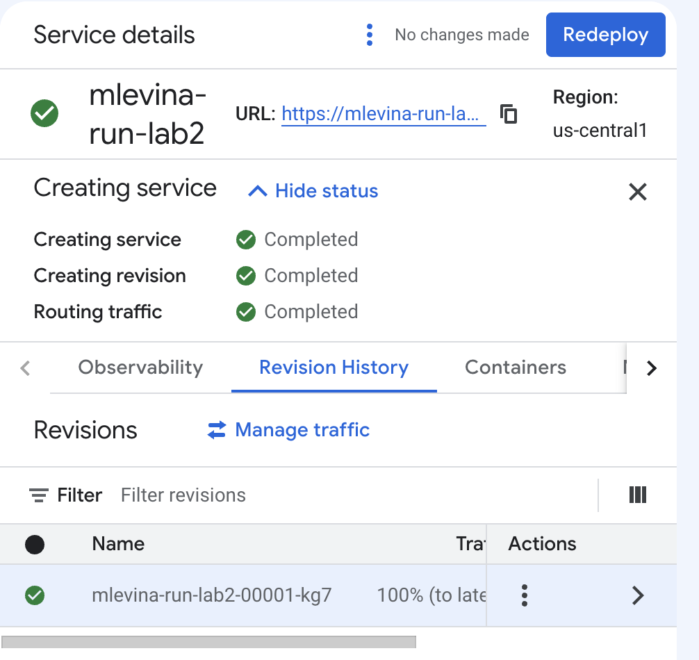

### 2. Тестирование

По выданной ссылке `https://mlevina-run-lab2-307056602443.us-central1.run.app` открывается страница *«It's running!»*. Она показывает, какая ревизия обработала запрос, — это пригодится в шаге 5.

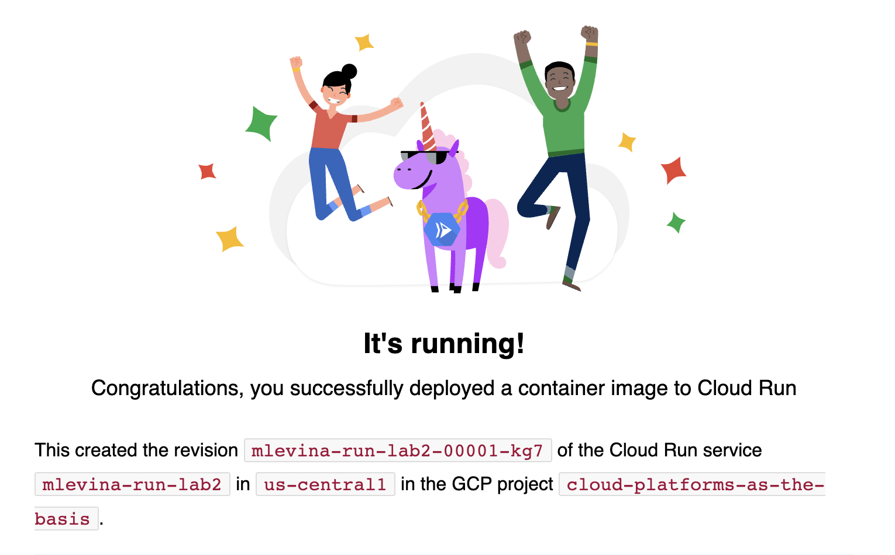

### 3. Логи и метрики

**Логи** (Observability → Logs) показывают жизненный цикл сервиса:

| Запись | Что означает |
|---|---|
| `Cloud Run CreateService` | создание сервиса (аудит-лог: кто и когда) |
| `Starting new instance. Reason: DEPLOYMENT` | Cloud Run запустил экземпляр контейнера при развёртывании |
| `Hello from Cloud Run! The container started successfully…` | сообщение самого приложения при старте |
| `Default STARTUP TCP probe succeeded` | проверка запуска: контейнер слушает порт, можно пускать трафик |
| `GET 200 4.95 KiB 2–9 ms` | запросы пользователей: метод, код ответа, размер, время ответа |

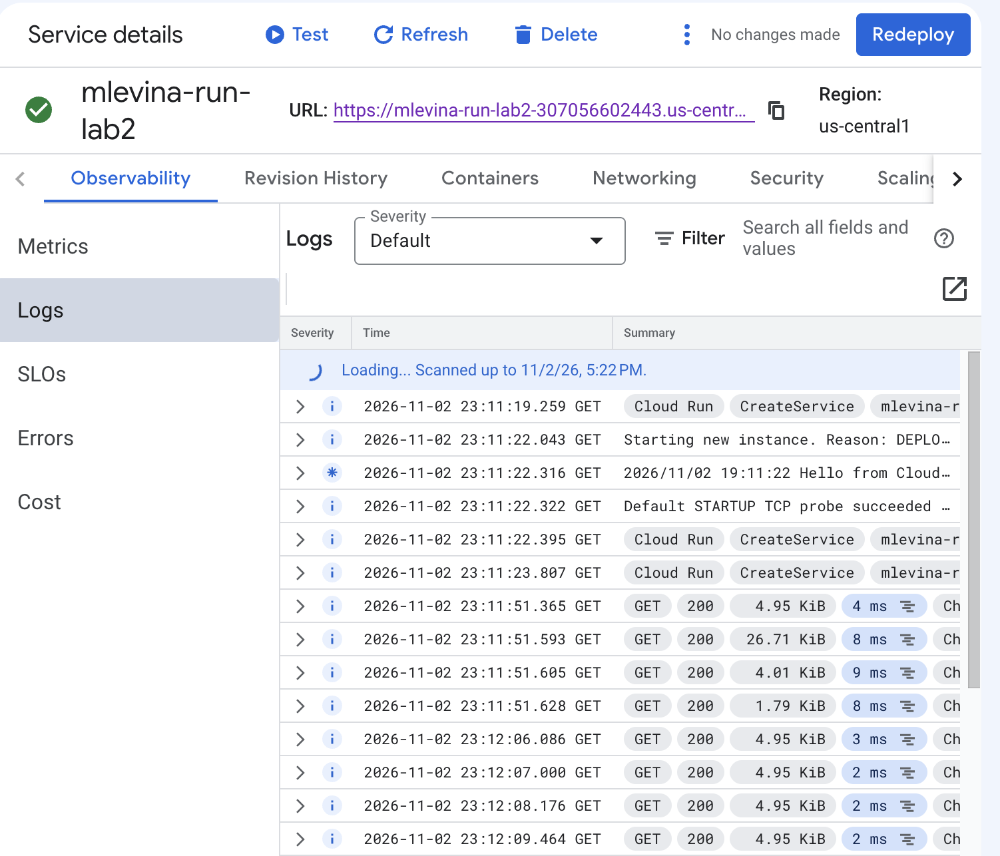

**Метрики** (Observability → Metrics) — графики числа запросов (по кодам ответа: все `2xx`), задержек (p50/p95/p99), числа экземпляров, загрузки CPU и памяти. На интервале 15 минут видны тестовые запросы: ~0,2 запроса в секунду, задержка 10–15 мс.

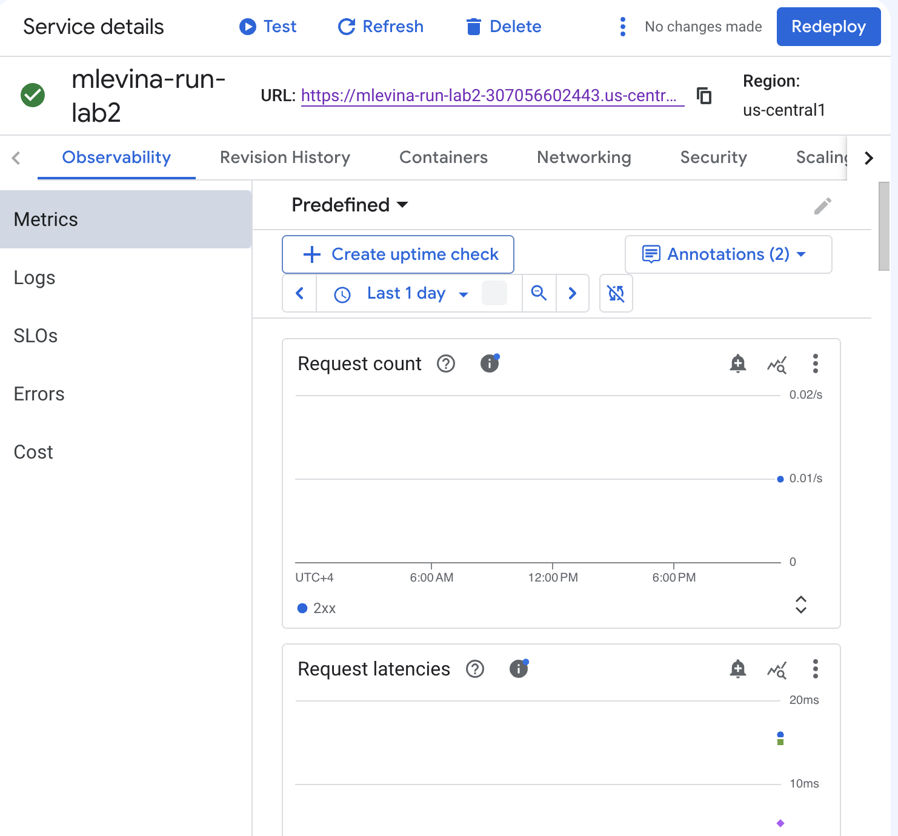

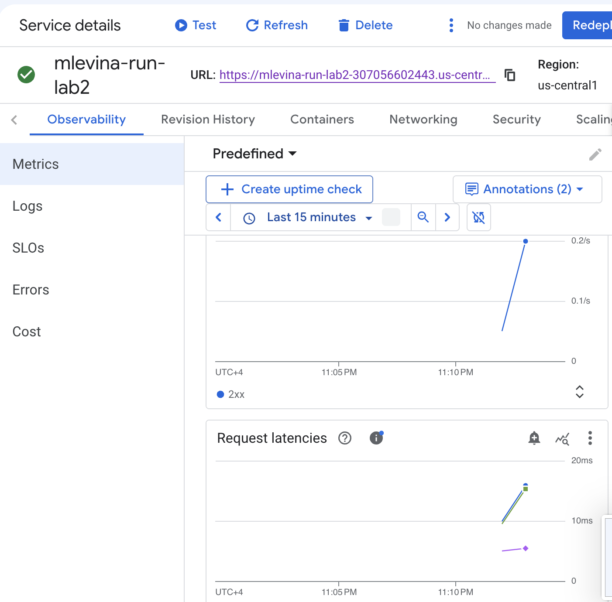

**Вывод:** логи отвечают на вопрос «что происходило и почему» (ошибки, старты, конкретные запросы), метрики — «как сервис работает в целом» (нагрузка, скорость, ресурсы). Вместе они позволяют замечать проблемы до жалоб пользователей и настраивать алерты.

### 4. Изменение порта на 8090

В настройках контейнера порт изменён с `8080` (по умолчанию) на `8090` → новая ревизия.

**Результат:** ревизия `mlevina-run-lab2-00002-nz6` успешно создана и получила трафик; сервис продолжил работать. Проверка запуска (*Startup probe*) теперь стучится на `tcp 8090`.

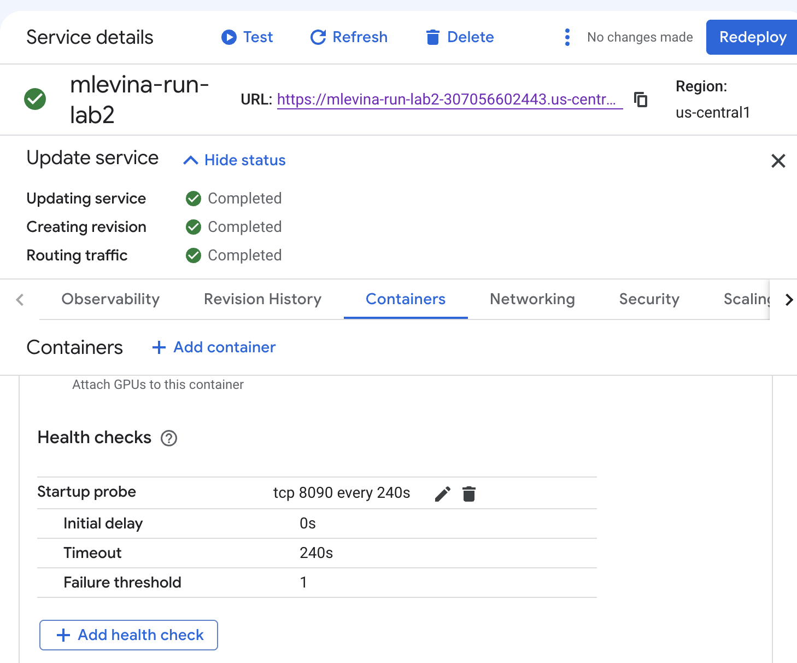

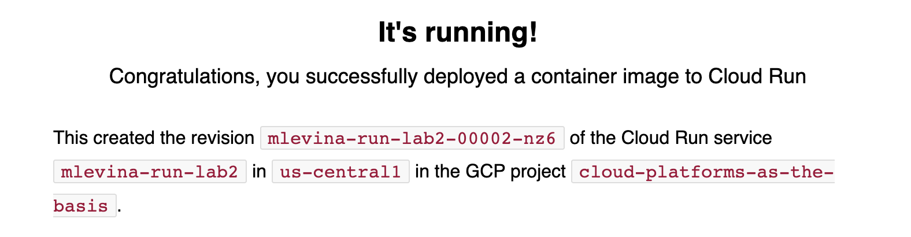

**Почему сервис не сломался.** Cloud Run передаёт контейнеру номер порта через переменную окружения `PORT` (здесь `PORT=8090`). Образ `hello` не жёстко привязан к 8080, а читает эту переменную — и начинает слушать 8090. Если бы приложение было жёстко настроено на 8080, проверка запуска не прошла бы, ревизия получила бы ошибку *«The user-provided container failed to start and listen on the port defined by PORT=8090»*, а трафик остался бы на предыдущей рабочей ревизии. Отсюда правило для своих сервисов: **порт брать из переменной `PORT`**.

### 5. Переключение трафика между ревизиями

В окне **Manage traffic** три режима:

| Режим | Что делает | Зачем |
|---|---|---|
| Send all traffic to the latest revision | новая ревизия сразу получает 100 % | обычный выпуск обновлений (было по умолчанию) |
| Send all traffic to one revision | 100 % на выбранную ревизию | **откат** на прошлую версию |
| Split traffic across multiple revisions | трафик делится в процентах | **канареечный релиз**, A/B-тест |

**Разделение 50/50.** Трафик поделён поровну между `00001-kg7` (порт 8080) и `00002-nz6` (порт 8090). При обновлении страницы ответ давала то одна, то другая ревизия.

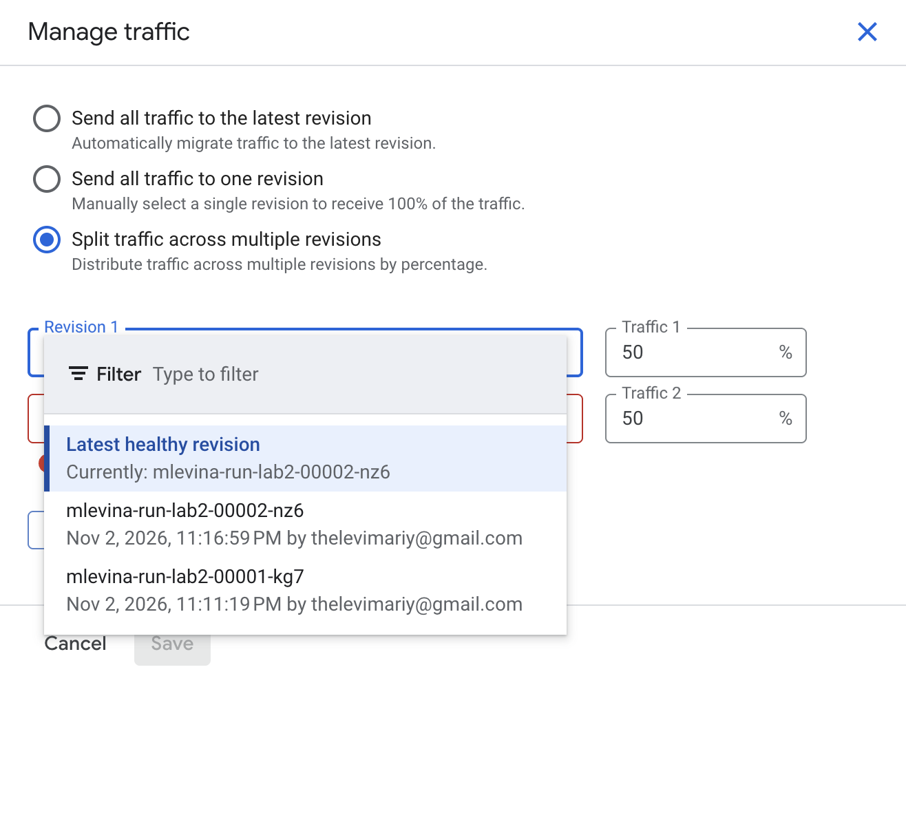

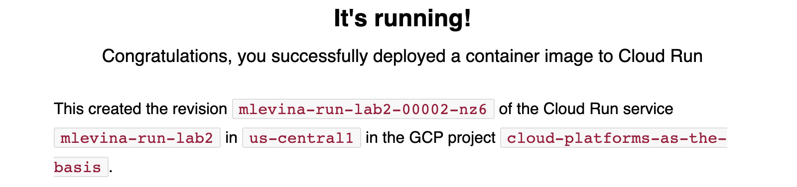

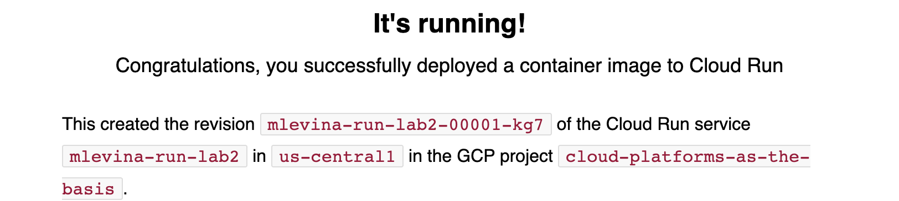

**Откат.** Затем весь трафик переведён на одну ревизию `00001-kg7` (*Send all traffic to one revision*) — статус *Migrating traffic*. Откат занимает секунды и не требует новой сборки: старая ревизия хранится и готова принять трафик.

**Сравнение ревизий.** Для пользователя обе ревизии одинаковы (одна и та же страница, время ответа — единицы миллисекунд); отличие только в конфигурации (порт). В реальном проекте при канареечном релизе новую версию сначала дают 5–10 % пользователей, сравнивают по метрикам ошибки и задержки и только потом переводят 100 %.

### 6. Удаление ресурсов

Сервис `mlevina-run-lab2` удалён вместе со всеми ревизиями (подтверждение вводом имени сервиса).

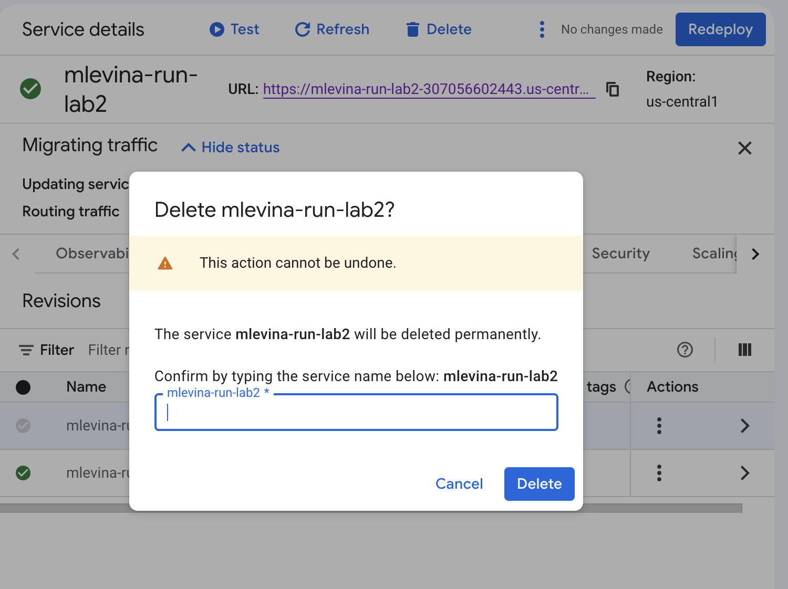

## Выводы

1. **Cloud Run позволяет запустить приложение за минуту без серверов**: передаёшь контейнер — получаешь HTTPS-адрес, автомасштабирование и оплату только за обработку запросов.
2. **Наблюдаемость встроена**: логи показывают каждый запрос и событие жизненного цикла (старт экземпляра, проверка запуска), метрики — нагрузку и задержки. Ничего не нужно настраивать отдельно.
3. **Каждое изменение — новая неизменяемая ревизия.** Это делает обновления безопасными: при проблеме трафик возвращается на прошлую ревизию за секунды.
4. **Порт приложения должен браться из переменной `PORT`**, тогда смена порта в настройках не ломает сервис. Неудачная ревизия не получает трафик — пользователи продолжают работать со старой.
5. **Распределение трафика** даёт канареечные релизы и A/B-тесты без дополнительной инфраструктуры — для стартапа это способ быстро выпускать изменения и при этом не рисковать всеми пользователями.
