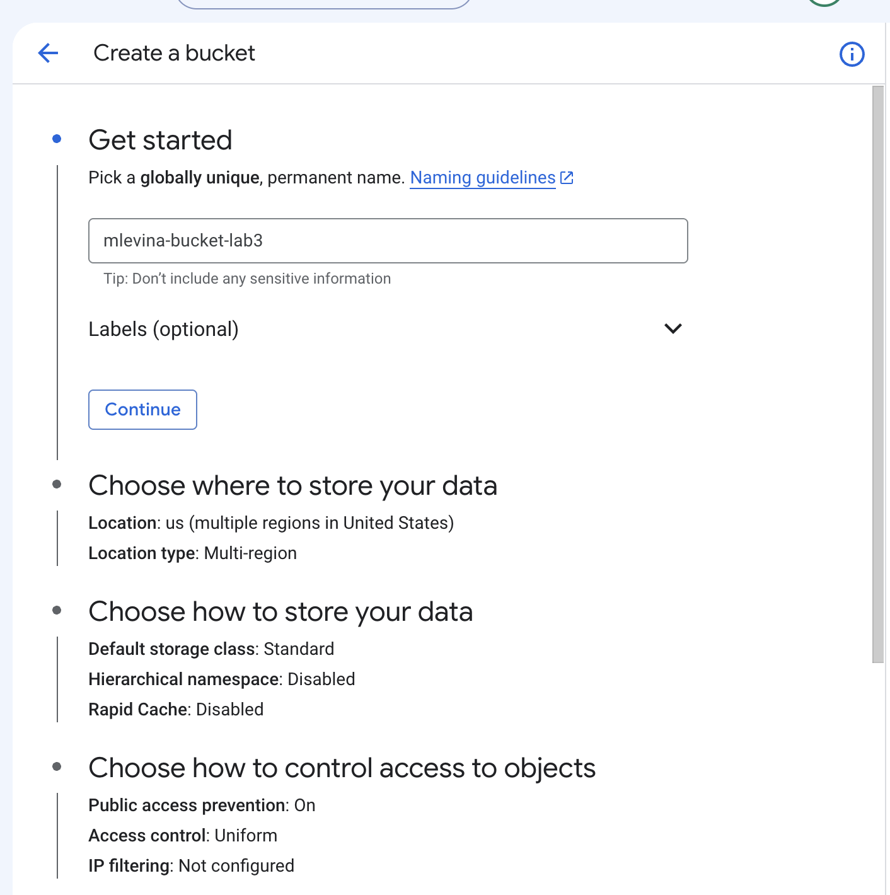
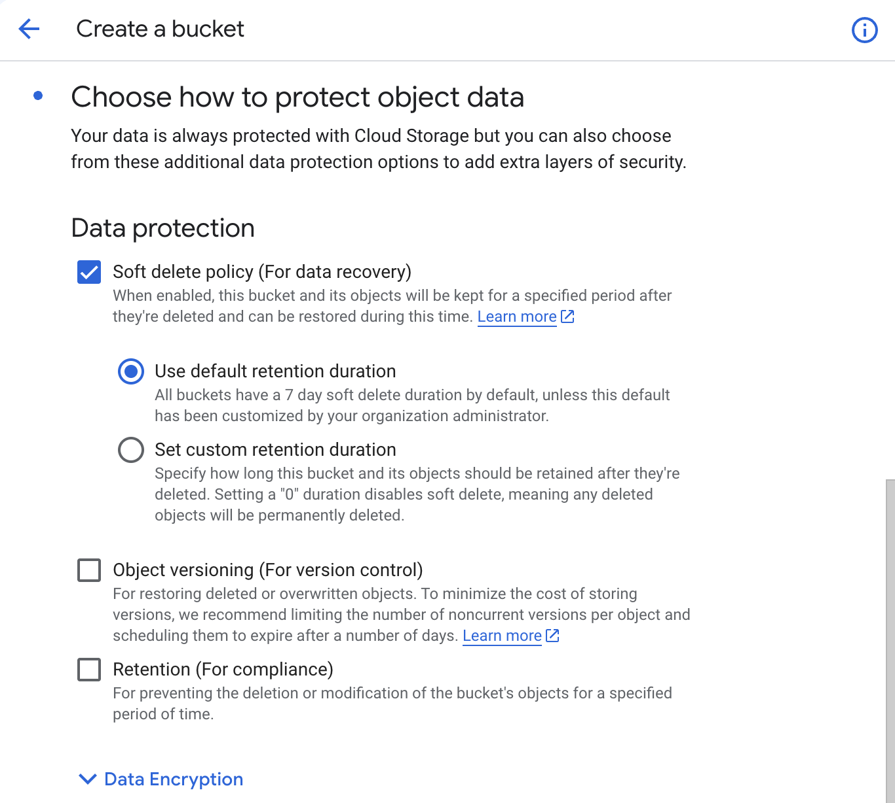
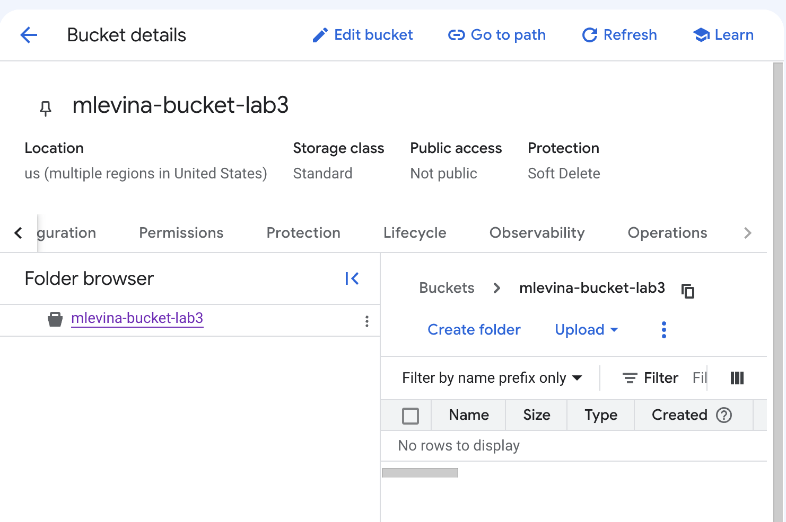
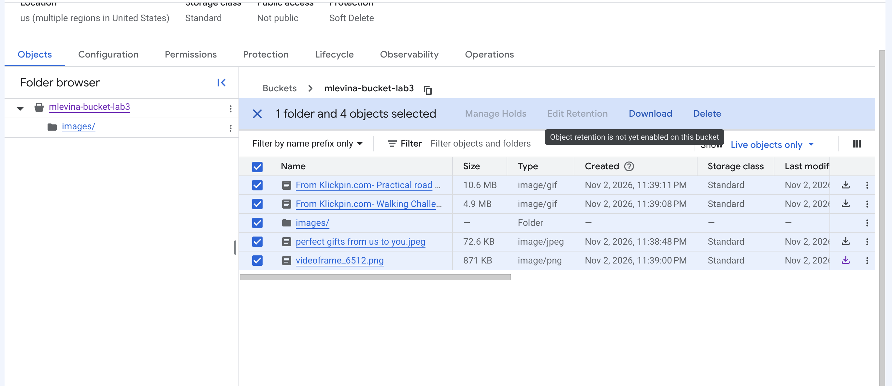
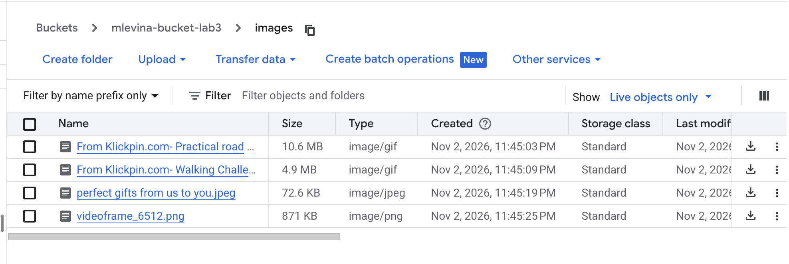
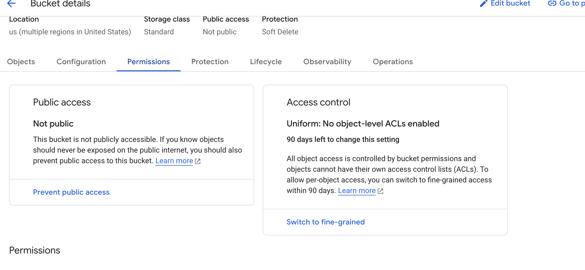
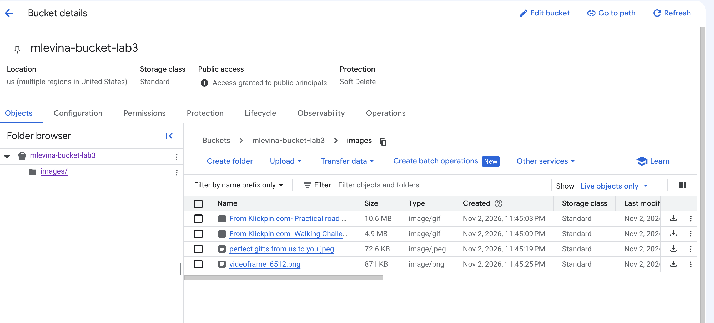
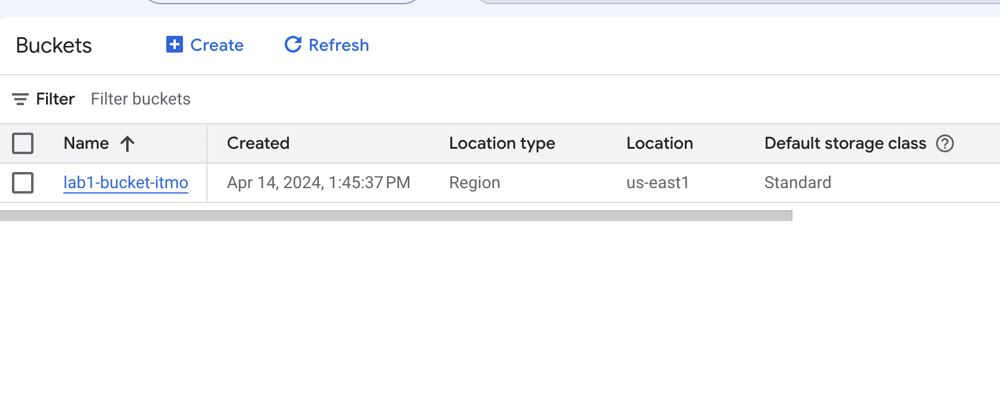
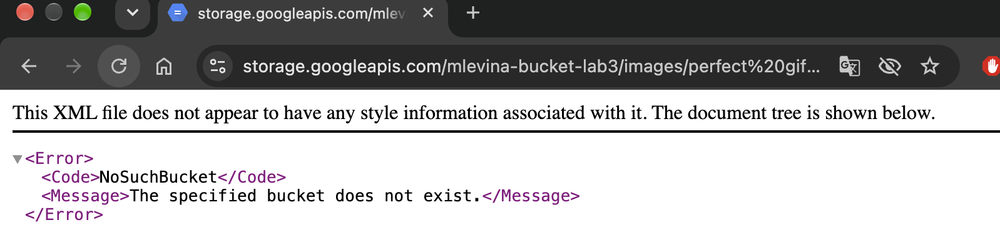

University: [ITMO University](https://itmo.ru/ru/)
Faculty: [FICT](https://fict.itmo.ru)
Course: [Cloud platforms as the basis of technology entrepreneurship](https://github.com/itmo-ict-faculty/cloud-platforms-as-the-basis-of-technology-entrepreneurship)
Year: 2026/2027
Group: U4225
Author: Levina Maria Yurievna
Lab: Lab3
Date of create: 02.11.2026
Date of finished: XX.XX.2026

# Лабораторная работа 3. Исследование Cloud Storage

**Цель:** познакомиться с принципами работы облачного хранилища, моделями хранения данных и основными функциями Cloud Storage: бакетами, объектами, «папками», публичным доступом и ссылками на файлы.

**Проект:** учебный проект курса `cloud-platforms-as-the-basis`.

## Модели хранения данных

| Модель | Как устроена | Пример в Google Cloud | Когда использовать |
|---|---|---|---|
| **Блочное** | диск, разбитый на блоки; ОС ставит поверх свою файловую систему | Persistent Disk, Hyperdisk (диски виртуальных машин) | диск ВМ, базы данных |
| **Файловое** | привычное дерево папок и файлов, доступ по сети (NFS) | Filestore | общие папки нескольких серверов, старые приложения |
| **Объектное** | плоское пространство объектов: данные + метаданные + уникальное имя, доступ по HTTP(S) | **Cloud Storage** | картинки, видео, бэкапы, статика сайтов, данные для аналитики и ИИ |

**Cloud Storage** — объектное хранилище: практически неограниченный объём, оплата за хранимые гигабайты и операции, доступ к каждому файлу по адресу `https://storage.googleapis.com/<бакет>/<объект>`. Основные понятия:

- **Бакет** — контейнер для объектов с глобально уникальным именем; у него задаются расположение, класс хранения и правила доступа.
- **Объект** — файл вместе с метаданными (тип, размер, дата создания).
- **Класс хранения** — Standard (частый доступ), Nearline, Coldline, Archive (редкий доступ: дешевле хранение, дороже чтение).

## Ход работы

### 1. Создание бакета

Создан бакет `mlevina-bucket-lab3` в учебном проекте. Мастер создания состоит из разделов:

| Раздел | Выбор | Пояснение |
|---|---|---|
| Имя | `mlevina-bucket-lab3` | глобально уникальное и постоянное |
| Где хранить | `us`, Multi-region | данные хранятся в нескольких регионах США — выше доступность, чуть дороже, чем один регион |
| Как хранить | Standard | для файлов, к которым часто обращаются |
| Контроль доступа | Uniform, публичный доступ не запрещён | права задаются на весь бакет через IAM |
| Защита данных | Soft delete 7 дней | удалённые объекты можно восстановить в течение 7 дней |



**Опции защиты данных:**
- **Soft delete** — «корзина»: удалённые объекты хранятся указанный срок (по умолчанию 7 дней) и могут быть восстановлены;
- **Object versioning** — при перезаписи сохраняются прежние версии объекта;
- **Retention** — запрет удаления и изменения объектов на заданный срок (требования законодательства, аудит).





### 2. Загрузка изображений

Через **Upload → Upload files** загружены 4 изображения разных форматов: два GIF (10,6 MB и 4,9 MB), JPEG (72,6 KB) и PNG (871 KB). Cloud Storage сам определил тип каждого объекта (`image/gif`, `image/jpeg`, `image/png`) — он передаётся браузеру при открытии файла.

### 3. Папка и перемещение файлов

Создана папка `images/`, файлы перемещены в неё (у каждого объекта — меню ⋮ → **Move**; массового перемещения в консоли нет).





**Наблюдение.** После перемещения у файлов изменилось время создания (*Created*: 23:39 → 23:45). В объектном хранилище **нет настоящих папок**: пространство имён плоское, а «папка» `images/` — это просто общий префикс в именах объектов (`images/videoframe_6512.png`). Поэтому «перемещение» — это копирование объекта под новым именем и удаление старого, и Cloud Storage создаёт новый объект.

### 4. Публичный доступ

До настройки бакет был закрыт: *Public access: Not public*. Консоль предлагает включить запрет публичного доступа (*Prevent public access*) — защиту от случайной публикации, которую Google включает по умолчанию.



Во вкладке **Permissions → Grant access** выдана роль **Storage Object Viewer** субъекту **`allUsers`** — «любой человек в интернете может просматривать и скачивать объекты» (но не изменять и не удалять). Статус бакета сменился на *Access granted to public principals*.



Связь с лабораторной работой 1: бакет `lab1-bucket-itmo` был открыт именно так, поэтому его файлы скачивались при любой роли сервисного аккаунта.

### 5. Ссылка на файл

На странице объекта скопирован **Public URL**:

```
https://storage.googleapis.com/mlevina-bucket-lab3/images/perfect%20gifts%20from%20us%20to%20you.jpeg
```

Ссылка открыта в браузере **в режиме инкогнито** — без входа в аккаунт Google картинка загружается. Пробелы в имени файла кодируются как `%20`.


### 6. Удаление ресурсов

Бакет `mlevina-bucket-lab3` удалён вместе с объектами (подтверждение вводом `DELETE`). В списке остался только бакет курса `lab1-bucket-itmo`.



После удаления та же публичная ссылка возвращает ошибку `NoSuchBucket` — *«The specified bucket does not exist»*: доступ к файлам пропал вместе с бакетом.



## Выводы

1. **Объектное хранилище** подходит для неструктурированных данных — изображений, видео, документов, бэкапов: объём не ограничен, каждый объект доступен по HTTP-ссылке, платим за хранимые гигабайты и операции.
2. **Папок в объектном хранилище нет** — есть префиксы в именах. Перемещение = копирование + удаление, это видно по изменившейся дате создания объектов.
3. **Доступ задаётся ролями IAM.** По умолчанию бакет закрыт и защищён от публикации; публичным его делает роль Storage Object Viewer для `allUsers`. Публиковать стоит только то, что действительно должно быть открытым (картинки товаров, статика сайта), и осознанно: публичный файл может скачать кто угодно.
4. **При создании бакета решаются важные вопросы:** где хранить (регион или мульти-регион — цена и надёжность), класс хранения (как часто нужны данные), защита (soft delete, версии, retention).
5. **Для бизнеса** Cloud Storage — простой способ хранить и раздавать файлы продукта без своего файлового сервера; в связке с Cloud CDN — быстрая раздача пользователям по всему миру (см. лабораторную работу 4).
