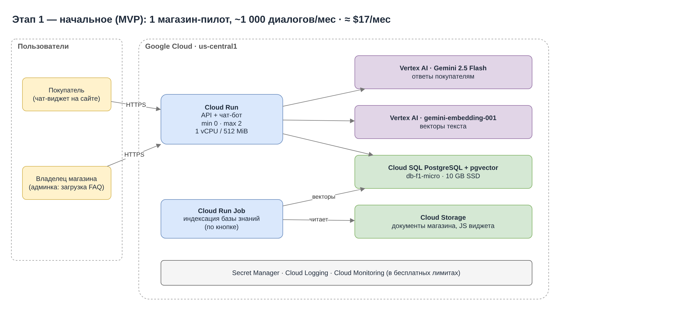
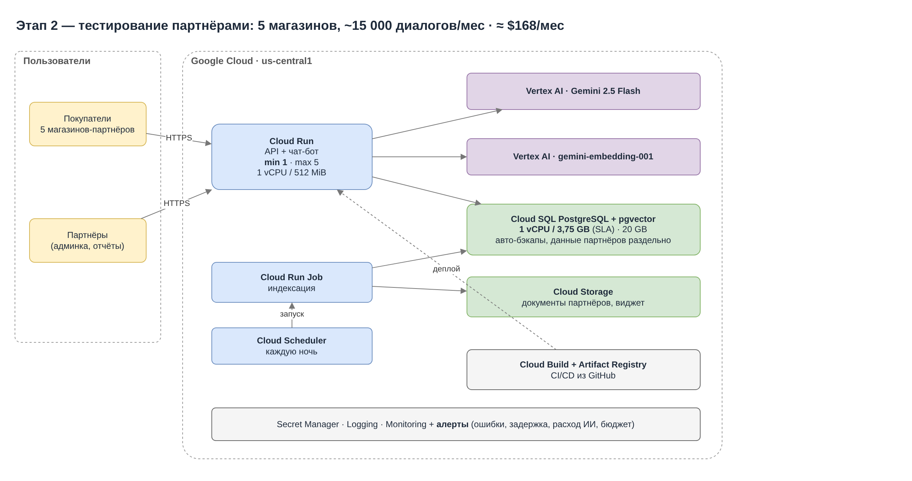
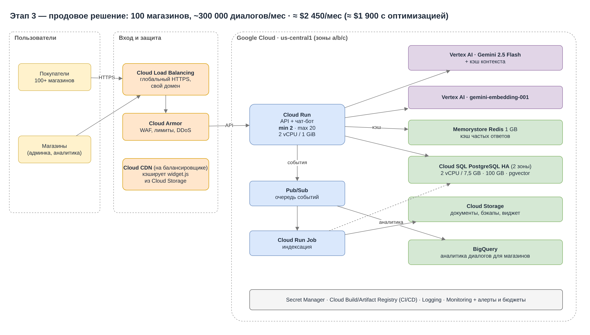

University: [ITMO University](https://itmo.ru/ru/)
Faculty: [FICT](https://fict.itmo.ru)
Course: [Cloud platforms as the basis of technology entrepreneurship](https://github.com/itmo-ict-faculty/cloud-platforms-as-the-basis-of-technology-entrepreneurship)
Year: 2026/2027
Group: U4225
Author: Levina Maria Yurievna
Lab: Lab4
Date of create: 02.11.2026
Date of finished: XX.XX.2026

# Лабораторная работа 4. Разработка инфраструктуры MVP AI-приложения

**Цель:** спроектировать инфраструктуру AI-приложения в Google Cloud для трёх состояний — начального, тестирования партнёрами и продового, — посчитать расходы на её содержание и обосновать выбор ресурсов.

Практической части в облаке нет: результат — схемы в draw.io и экономическая модель.

**Файлы:**
- [`diagrams/shopassist_infra.drawio`](diagrams/shopassist_infra.drawio) — схема (3 страницы, по одной на этап), открывается в [app.diagrams.net](https://app.diagrams.net);
- [`cost_model.py`](cost_model.py) — расчёт расходов: все цены и допущения в начале файла, запуск `python3 cost_model.py`.

## 1. Исходные данные: приложение ShopAssist

**ShopAssist** — AI-консультант для интернет-магазинов. Магазин вставляет на сайт чат-виджет, и покупатели получают ответы 24/7: о доставке, оплате, возвратах, наличии и характеристиках товаров. Ответы строятся на базе знаний конкретного магазина (FAQ, правила, каталог) по схеме **RAG** (Retrieval-Augmented Generation):

1. Владелец магазина загружает документы → они режутся на фрагменты, каждый превращается в вектор (embedding) и сохраняется в базе.
2. Покупатель задаёт вопрос → вопрос тоже превращается в вектор, в базе ищутся самые похожие фрагменты.
3. Вопрос + найденные фрагменты отправляются языковой модели → она формулирует ответ только по фактам магазина.

Если ответа нет, бот предлагает связаться с оператором. Владелец видит в админке статистику: частые вопросы, вопросы без ответа.

**Почему такой продукт хорош для облака:** нагрузка неравномерная (пики в вечерние часы и распродажи), а платить нужно за реальное использование — от одного пилотного магазина до сотен.

### Предполагаемые нагрузки по этапам

| Параметр | 1. Начальное (MVP) | 2. Тест партнёрами | 3. Продовое решение |
|---|---|---|---|
| Магазинов | 1 (пилот) | 5 партнёров | 100 |
| Диалогов в месяц | ~1 000 | ~15 000 | ~300 000 |
| Сообщений в месяц (×4) | ~4 000 | ~60 000 | ~1 200 000 |
| Пиковая нагрузка | единицы запросов в минуту | ~1 запрос/с | ~20 запросов/с (распродажи) |
| Требования | работает, дёшево | без «холодного старта», SLA базы, CI/CD, мониторинг | отказоустойчивость, защита, масштабирование, аналитика |

### Допущения модели

- 1 диалог = 4 сообщения покупателя.
- На 1 сообщение модель получает ~3 000 токенов (инструкция + найденные фрагменты + история) и отвечает ~300 токенами.
- Обработка сообщения занимает ~3 с (в основном ожидание ответа модели).
- База знаний одного магазина — ~1 млн токенов.
- Цены — регион `us-central1`, on-demand, USD, по состоянию на ноябрь 2026 (источники в конце). 1 месяц = 730 часов.

## 2. Выбор сервисов и обоснование

| Задача | Сервис | Почему он, а не альтернатива |
|---|---|---|
| Бэкенд (API + чат-бот) | **Cloud Run** | Оплата только за время обработки запросов, масштабирование от 0 до сотен экземпляров без ручной настройки, деплой из контейнера. ВМ Compute Engine пришлось бы держать включённой 24/7 и масштабировать самим. GKE (Kubernetes) избыточен для одного сервиса |
| Языковая модель | **Vertex AI, Gemini 2.5 Flash** | Быстрая и дешёвая модель ($0,30 / $2,50 за 1 млн токенов) с качеством, достаточным для ответов по базе знаний. Работает внутри Google Cloud: не нужны внешние ключи, данные не уходят третьим сторонам. Модели уровня Pro в разы дороже, а для FAQ-ответов не дают заметного выигрыша |
| Векторы (embeddings) | **Vertex AI, gemini-embedding-001** | $0,15 за 1 млн токенов, поддержка русского языка |
| База данных и векторный поиск | **Cloud SQL PostgreSQL + pgvector** | Одна база для всего: диалоги, магазины, пользователи **и** векторный поиск. Управляемый сервис: бэкапы, обновления, HA одной галочкой. Отдельная векторная БД (Vertex AI Vector Search) на таких объёмах дороже и усложняет архитектуру |
| Файлы | **Cloud Storage** | Документы магазинов, JS виджета, бэкапы; $0,02 за GB в месяц |
| Индексация документов | **Cloud Run Jobs** (+ Cloud Scheduler) | Пакетная задача, которая запускается и останавливается; платим только за время работы |
| Кэш частых ответов (этап 3) | **Memorystore for Redis** | Одинаковые вопросы («сколько стоит доставка») отдаются из кэша без вызова модели — экономия на самой дорогой статье |
| Вход, защита (этап 3) | **Cloud Load Balancing + Cloud Armor + Cloud CDN** | Свой домен и TLS, защита от DDoS и ботов, лимиты запросов на магазин, быстрая раздача виджета по всему миру |
| Аналитика (этап 3) | **Pub/Sub → BigQuery** | События диалогов уходят в аналитическое хранилище, не нагружая основную базу |
| Секреты, CI/CD, наблюдаемость | **Secret Manager, Cloud Build + Artifact Registry, Cloud Logging/Monitoring** | Ключи не в коде; автодеплой из GitHub; алерты на ошибки, задержки и бюджет |

## 3. Этап 1 — начальное состояние (MVP)

**Задача этапа:** проверить гипотезу на одном магазине-пилоте с минимальными расходами.

**Решения:**
- Cloud Run с `min instances = 0`: когда никто не пишет, сервис «спит» и ничего не стоит. Первый ответ после простоя на ~1–2 с дольше (холодный старт) — для пилота допустимо. Вся нагрузка укладывается в бесплатный лимит Cloud Run.
- Cloud SQL **db-f1-micro** — самый маленький экземпляр PostgreSQL (без SLA). Но это уже та же СУБД и та же схема данных, что будут в проде.
- Индексация запускается вручную кнопкой в админке.
- Logging, Monitoring, Secret Manager — в бесплатных лимитах.

| Сервис | Конфигурация | $/мес |
|---|---|---|
| Vertex AI Gemini 2.5 Flash | 1 000 диалогов × 4 сообщения × (3 000 вход + 300 выход токенов) | 6,60 |
| Vertex AI embeddings | вопросы + индексация базы 1 млн токенов | 0,18 |
| Cloud Run | min 0, max 2, 1 vCPU / 512 MiB — в бесплатном лимите | 0,00 |
| Cloud SQL PostgreSQL | db-f1-micro, 10 GB SSD, бэкапы | 10,17 |
| Cloud Storage | 1 GB | 0,02 |
| Secret Manager, Logging, Monitoring | 3 секрета, логи в бесплатных 50 GiB | 0,30 |
| **Итого** | | **≈ $17/мес** |

## 4. Этап 2 — тестирование партнёрами

**Задача этапа:** 5 магазинов-партнёров пользуются продуктом каждый день. Нужны стабильность, предсказуемое время ответа и быстрый выпуск исправлений.

**Что изменилось и почему:**
- **Cloud Run `min instances = 1`** — один экземпляр всегда «прогрет», покупатели партнёров не ждут холодного старта. Стоит ~$10/мес.
- **Cloud SQL 1 vCPU / 3,75 GB** вместо shared-core: у shared-core экземпляров нет SLA, а партнёрам мы его обещаем. Включены автоматические бэкапы. Данные магазинов разделены по `shop_id` (мульти-тенантность) — это закладывается сейчас, пока данных мало.
- **Cloud Scheduler + Cloud Run Job** — ночная переиндексация, чтобы бот знал об изменениях в каталоге.
- **CI/CD: Cloud Build + Artifact Registry** — каждое исправление из GitHub автоматически собирается и выкатывается новой ревизией Cloud Run; при проблеме — откат переключением трафика на прошлую ревизию.
- **Алерты Cloud Monitoring** на ошибки, задержку ответа и **бюджет** на расход Vertex AI.

| Сервис | Конфигурация | $/мес |
|---|---|---|
| Vertex AI Gemini 2.5 Flash | 15 000 диалогов | 99,00 |
| Vertex AI embeddings | вопросы + ночная переиндексация 5 магазинов | 3,45 |
| Cloud Run | min 1, max 5, 1 vCPU / 512 MiB | 9,86 |
| Cloud SQL PostgreSQL | 1 vCPU / 3,75 GB (SLA), 20 GB SSD, бэкапы | 54,31 |
| Cloud Storage | 10 GB | 0,20 |
| Cloud Build, Artifact Registry | CI/CD, ~30 сборок | 1,00 |
| Cloud Scheduler, Secret Manager, Monitoring | 1 задание, секреты, алерты | 0,60 |
| **Итого** | | **≈ $168/мес** |

## 5. Этап 3 — продовое решение

**Задача этапа:** 100 магазинов, ~300 000 диалогов в месяц, пики на распродажах. Сервис должен переживать отказ зоны, быть защищён от атак и масштабироваться без ручных действий.

**Что изменилось и почему:**
- **Глобальный HTTPS Load Balancer** — свой домен и сертификат, единая точка входа. На нём включены **Cloud Armor** (WAF, защита от DDoS, лимит запросов на магазин — чтобы один магазин или бот не «съел» бюджет на ИИ) и **Cloud CDN** для JS виджета.
- **Cloud Run `min 2`, `max 20`, 2 vCPU / 1 GiB** — два прогретых экземпляра в разных зонах, автомасштабирование до 20 на распродажах.
- **Cloud SQL в режиме HA** — копия базы в другой зоне, автоматическое переключение при отказе. 2 vCPU / 7,5 GB, 100 GB.
- **Memorystore Redis** — кэш ответов на частые вопросы. При 25 % попаданий в кэш экономия на модели ≈ $495/мес — сервис окупается в 14 раз.
- **Pub/Sub → BigQuery** — события диалогов для аналитики магазинов, без нагрузки на основную базу. Pub/Sub также запускает переиндексацию при загрузке новых документов.

| Сервис | Конфигурация | $/мес |
|---|---|---|
| Vertex AI Gemini 2.5 Flash | 300 000 диалогов | 1 980,00 |
| Vertex AI embeddings | вопросы + еженедельная переиндексация 100 магазинов | 69,00 |
| Cloud Run | min 2, max 20, 2 vCPU / 1 GiB | 43,74 |
| Cloud SQL PostgreSQL HA | 2 vCPU / 7,5 GB, 100 GB SSD, бэкапы | 239,25 |
| Memorystore Redis | Basic, 1 GB | 35,77 |
| Cloud Load Balancing | 1 правило, ~100 GB трафика | 19,85 |
| Cloud Armor | 1 политика, 5 правил, 1,5 млн запросов | 11,12 |
| Cloud CDN + исходящий трафик | ~100 GB | 8,00 |
| Cloud Storage | 200 GB | 4,00 |
| BigQuery | ~50 GB, запросы в бесплатном 1 ТБ | 5,00 |
| Cloud Logging | ~100 GiB (50 GiB бесплатно) | 25,00 |
| Pub/Sub, Scheduler, Secret Manager, Build | в основном бесплатные лимиты | 6,00 |
| **Итого** | | **≈ $2 450/мес** |

**Оптимизация продовых расходов:**

| Мера | Экономия, $/мес |
|---|---|
| Кэш частых ответов в Redis (25 % попаданий) | ≈ 495 |
| Committed use discount на Cloud SQL (обязательство на 1 год, −25 %) | ≈ 49 |
| **Итого после оптимизации** | **≈ $1 900/мес** |

Дальнейший резерв — кэширование контекста в Vertex AI (инструкция повторяется в каждом запросе) и сокращение числа фрагментов в промпте с 3 000 до ~2 000 токенов.

## 6. Экономическая модель

| Показатель | Этап 1 | Этап 2 | Этап 3 | Этап 3 (оптим.) |
|---|---|---|---|---|
| Расходы, $/мес | 17 | 168 | 2 447 | ≈ 1 900 |
| Доля нейросети (Vertex AI) | 40 % | 61 % | 84 % | ≈ 80 % |
| На 1 диалог, $ | 0,017 | 0,011 | 0,008 | ≈ 0,006 |
| На 1 магазин, $/мес | 17 | 34 | 24 | ≈ 19 |

**Выводы из модели:**
- На старте основную часть расходов составляет «постоянная» инфраструктура (база), в проде — нейросеть: она растёт линейно с числом диалогов. Поэтому главные рычаги экономии в проде — кэш ответов, размер промпта и выбор модели, а не серверы.
- Стоимость одного диалога падает с ростом: постоянные расходы делятся на большее число пользователей.
- **Ценообразование:** при себестоимости ≈ $19–24 на магазин тариф **$49/мес** за магазин (до 3 000 диалогов) даёт маржу ≈ 50–60 %; сверх лимита — оплата за диалоги. Для 100 магазинов: выручка ≈ $4 900 против ≈ $1 900–2 450 расходов.

## 7. «Самое дешёвое не всегда оптимально»

Несколько решений сознательно дороже минимально возможного уже на первом этапе:

| Решение | Дешевле на старте | Почему выбрали иначе |
|---|---|---|
| **Cloud Run, а не ВМ** | ВМ e2-micro в бесплатном лимите стоит $0 | ВМ не масштабируется сама, её нужно обновлять и чинить; на этапах 2–3 пришлось бы переписывать деплой. Cloud Run на старте тоже ≈ $0, а дальше масштабируется без изменения архитектуры |
| **Cloud SQL PostgreSQL с первого дня, а не Firestore** | Firestore на MVP-нагрузке бесплатен (≈ −$10/мес) | Нужны связи «магазин — документы — диалоги», отчёты SQL и векторный поиск pgvector. Миграция базы с живыми данными партнёров — самая рискованная операция; дешевле сразу выбрать СУБД, которая доживёт до прода, и просто увеличивать её размер |
| **Мульти-тенантная схема с этапа 2** | Отдельная копия под каждого партнёра проще | При 100 магазинах отдельные копии = 100 баз и 100 деплоев |
| **min instances = 1 на этапе 2** | min 0 бесплатен | Холодный старт портит впечатление партнёров — это стоит дороже $10/мес |
| **Gemini Flash, а не самая мощная модель** | — | Наоборот: самая дорогая модель не нужна. Flash достаточно для ответов по базе знаний, а на проде модель — 80 % расходов |

## Выводы

1. Для AI-приложения основная статья расходов в масштабе — **вызовы нейросети**, а не серверы: на проде ≈ 80 % бюджета. Поэтому экономику определяют размер промпта, кэш и выбор модели.
2. **Serverless-сервисы** (Cloud Run, Cloud Run Jobs, Pub/Sub) позволяют начать почти бесплатно и вырасти в 300 раз по нагрузке без смены архитектуры — меняются только настройки (min/max экземпляров, размер базы, HA).
3. Каждый этап добавляет то, что становится важным именно на нём: на MVP — минимальная цена; на тесте партнёрами — стабильность, SLA, CI/CD и мониторинг; в проде — отказоустойчивость, защита и аналитика.
4. Выбор «на вырост» (Cloud Run, PostgreSQL, мульти-тенантность) стоит на старте чуть дороже минимума, но избавляет от дорогих миграций на следующих этапах.

## Источники цен

- [Cloud Run pricing](https://cloud.google.com/run/pricing)
- [Cloud SQL pricing](https://cloud.google.com/sql/docs/billing)
- [Memorystore for Redis pricing](https://cloud.google.com/memorystore/docs/redis/pricing)
- [Cloud Load Balancing pricing](https://cloud.google.com/load-balancing/pricing)
- [Google Cloud Armor pricing](https://cloud.google.com/armor/pricing)
- Gemini 2.5 Flash на Vertex AI: $0,30 / $2,50 за 1 млн токенов — [сводка цен Vertex AI](https://www.getmaxim.ai/bifrost/llm-cost-calculator/provider/vertex_ai/model/gemini-2.5-flash)
- gemini-embedding-001: $0,15 за 1 млн токенов — [Google Developers Blog](https://developers.googleblog.com/gemini-embedding-available-gemini-api/)
